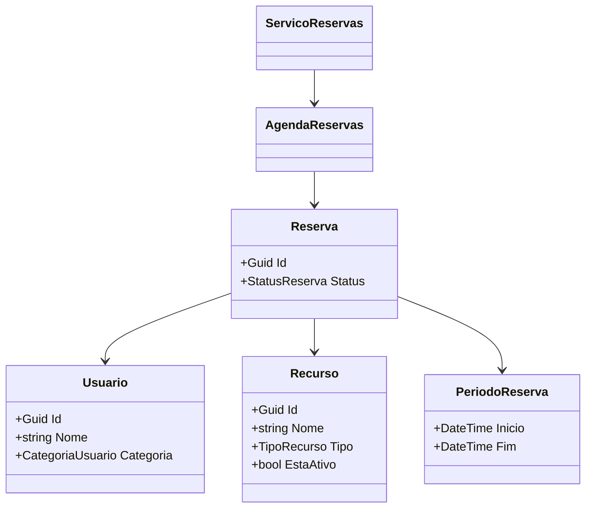

# Modelo inicial

O modelo abaixo representa apenas a estrutura inicial recebida. Ele contém simplificações e não deve ser tratado como gabarito.

Crie `MODELO-FINAL.md` com o modelo correspondente à solução entregue.
